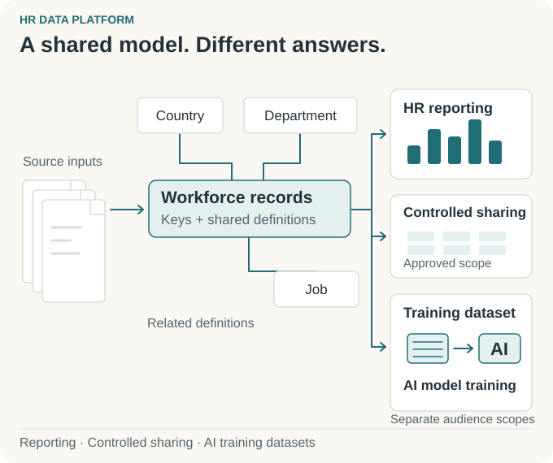
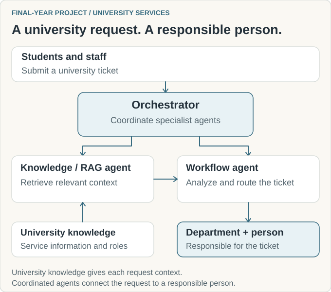
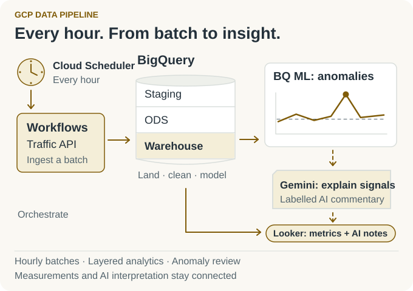
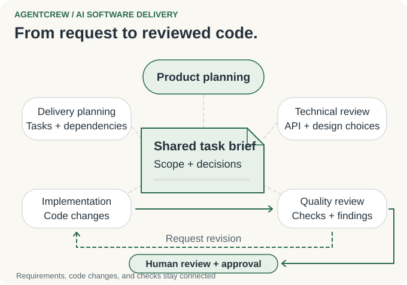
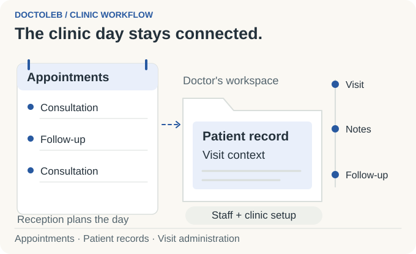

# Mahdi Hajj Hassan | Data engineering & applied AI

> [!CAUTION]
> **Critical HR information, handled responsibly.** At Thales, I delivered pipelines and reporting for critical HR data covering tens of thousands of employees worldwide. Public showcases use independent examples, with no Thales implementation or data and no employer endorsement. Private application code stays private; diagrams explain project workflows.

I'm **Mahdi**, a **data engineer at Thales** in **Beirut, Lebanon**, and a **42 Beirut alumnus**. I delivered enterprise HR pipelines and reporting and supplied datasets for AI model training. I also shipped AI workflows and built a multi-agent system for a university that routes student and staff requests to the right people.

My work connects **data engineering, AI workflows, and the applications people use to get work done**.

[Email](mailto:mahdihajjhassan.business@gmail.com) · [LinkedIn](https://www.linkedin.com/in/mahdi-hajj-hassan-5b953b312/)

## Selected projects

- [**HR Data Platform**](https://github.com/MahdiHajjHassan/workforce-data-platform): enterprise HR reporting, controlled sharing, and datasets for AI model training.
- [**University Multi-Agent Ticket Routing**](https://github.com/MahdiHajjHassan/university-ticket-orchestration): university knowledge retrieval and agent coordination that connect a request to the department and person responsible.
- [**GCP Data Pipeline**](https://github.com/MahdiHajjHassan/MahdiHajjHassan/blob/main/projects/gcp-data-pipeline/README.md): scheduled ingestion, analytics, anomaly scoring, and AI interpretation.
- [**AgentCrew**](https://github.com/MahdiHajjHassan/ai-development-workflow): an AI software delivery workflow from feature request to code review and human approval.
- [**PolicyForge**](https://github.com/MahdiHajjHassan/policy-aware-data-generator): synthetic development datasets shaped by team, role, country, and field permissions.
- [**Doctoleb**](https://github.com/MahdiHajjHassan/doctoleb-showcase): appointments, patient records, and clinic administration in a multilingual application.
- [**Restaurant Websites**](https://github.com/MahdiHajjHassan/Restaurant-app): branded bilingual sites with menu management and separate owner/operator controls.

## 01 / HR Data Platform

**Reliable HR information for reporting, sharing, and AI training.** At Thales, I delivered ingestion, transformations, data models, and reporting for a global workforce. I also supplied HR datasets for AI model training. HR analysts, authorized business teams, and AI teams needed different outputs from the same underlying information.

<picture>
  <source media="(prefers-color-scheme: dark) and (max-width: 540px)" srcset="assets/workforce-story-v4-mobile-dark.svg">
  <source media="(max-width: 540px)" srcset="assets/workforce-story-v4-mobile-light.svg">
  <source media="(prefers-color-scheme: dark)" srcset="assets/workforce-story-v4-dark.svg">
  
</picture>

[HR project and engineering details →](https://github.com/MahdiHajjHassan/workforce-data-platform)

## 02 / University Multi-Agent Ticket Routing

**A university request should reach the person who can resolve it.** I built an orchestrator for a university that coordinated two specialist agents: one retrieved relevant university knowledge, and another analyzed the request and routed the ticket to the responsible department and person. Students and staff used the same entry point for different service needs.

<picture>
  <source media="(prefers-color-scheme: dark) and (max-width: 520px)" srcset="assets/university-ticket-story-v2-mobile-dark.svg">
  <source media="(max-width: 520px)" srcset="assets/university-ticket-story-v2-mobile-light.svg">
  <source media="(prefers-color-scheme: dark)" srcset="assets/university-ticket-story-v2-dark.svg">
  
</picture>

[University project: agents, retrieval, and routing →](https://github.com/MahdiHajjHassan/university-ticket-orchestration)

## 03 / GCP Data Pipeline

**From incoming data to an analyst's next question.** I built an ingestion-to-analytics pipeline with Dataflow, BigQuery, and Cloud Workflows. The traffic workflow below explains scheduled collection, consistent analytical tables, anomaly scoring, and AI commentary alongside the measured values.

<picture>
  <source media="(prefers-color-scheme: dark) and (max-width: 520px)" srcset="assets/gcp-story-v4-mobile-dark.svg">
  <source media="(max-width: 520px)" srcset="assets/gcp-story-v4-mobile-light.svg">
  <source media="(prefers-color-scheme: dark)" srcset="assets/gcp-story-v4-dark.svg">
  
</picture>

[GCP pipeline and AI analysis →](https://github.com/MahdiHajjHassan/MahdiHajjHassan/blob/main/projects/gcp-data-pipeline/README.md)

## 04 / AgentCrew: AI Software Delivery Workflow

**Turn a feature request into a change someone can review.** I designed an AI workflow with distinct planning, technical review, implementation, and quality review responsibilities. Each stage used the same requirements and decisions; the product owner reviewed the code changes and check results before approval.

<picture>
  <source media="(max-width: 540px) and (prefers-color-scheme: dark)" srcset="assets/ai-story-v4-mobile-dark.svg">
  <source media="(max-width: 540px)" srcset="assets/ai-story-v4-mobile-light.svg">
  <source media="(prefers-color-scheme: dark)" srcset="assets/ai-story-v4-dark.svg">
  
</picture>

[AgentCrew workflow and task examples →](https://github.com/MahdiHajjHassan/ai-development-workflow)

## 05 / PolicyForge: Permission-Aware Development Data

**Give each team development data that matches its access.** I developed a configurable synthetic-data generator that shaped datasets for different recipients. Operations, finance, and partner teams could receive different fields, with country rules further narrowing what each dataset contained.

<picture>
  <source media="(prefers-color-scheme: dark) and (max-width: 540px)" srcset="assets/policy-story-v3-mobile-dark.svg">
  <source media="(max-width: 540px)" srcset="assets/policy-story-v3-mobile-light.svg">
  <source media="(prefers-color-scheme: dark)" srcset="assets/policy-story-v3-dark.svg">
  
</picture>

[PolicyForge design and example datasets →](https://github.com/MahdiHajjHassan/policy-aware-data-generator)

## 06 / Doctoleb: Clinic Management

**Appointments, patient records, and visit administration in one workflow.** I developed Doctoleb around receptionists, doctors, and clinic administrators. I designed English, Arabic, and French interfaces, staff access rules, and local browser operation with synchronization for interrupted connectivity.

<picture>
  <source media="(prefers-color-scheme: dark) and (max-width: 520px)" srcset="assets/clinic-story-v4-mobile-dark.svg">
  <source media="(max-width: 520px)" srcset="assets/clinic-story-v4-mobile-light.svg">
  <source media="(prefers-color-scheme: dark)" srcset="assets/clinic-story-v4-dark.svg">
  
</picture>

[Doctoleb product and architecture →](https://github.com/MahdiHajjHassan/doctoleb-showcase)

## 07 / Restaurant Websites

**A shared application, with each restaurant's own identity.** I developed bilingual restaurant sites, owner tools for menus and branding, and operator tools for onboarding. I connected restaurant domains, isolated business data, reusable themes, and photo processing in one codebase.

<picture>
  <source media="(prefers-color-scheme: dark) and (max-width: 520px)" srcset="assets/restaurant-story-v3-mobile-dark.svg">
  <source media="(max-width: 520px)" srcset="assets/restaurant-story-v3-mobile-light.svg">
  <source media="(prefers-color-scheme: dark)" srcset="assets/restaurant-story-v3-dark.svg">
  
</picture>

[Restaurant application and architecture →](https://github.com/MahdiHajjHassan/Restaurant-app)

## Technical background

<strong>Enterprise delivery and systems foundations</strong>

### Data engineering at Thales

I delivered SQL Server stored procedures and Talend ETL pipelines feeding HR operational and analytical systems. My work included data modeling, validation, Power BI reporting, deployment, and production troubleshooting. I supplied HR datasets for AI model training and worked with GCP Dataflow, BigQuery, and Cloud Workflows.

I clarified requirements with the product owner, discussed architecture with the technical lead, and coordinated delivery with engineers and interns.

### Software engineering at 42 Beirut

I'm a **42 Beirut alumnus**. C and C++ projects developed my experience with algorithms, data structures, Unix processes, filesystems, networking, debugging, testing, and peer review. My application work also covered Python APIs, web applications, and Electron desktop software.

<a href="https://www.thalesgroup.com/"><picture><source media="(prefers-color-scheme: dark)" srcset="https://raw.githubusercontent.com/MahdiHajjHassan/MahdiHajjHassan/main/assets/thales-dark.svg"></picture></a>&nbsp;&nbsp;&nbsp;
<a href="https://www.42beirut.com/"><picture><source media="(prefers-color-scheme: dark)" srcset="https://raw.githubusercontent.com/MahdiHajjHassan/MahdiHajjHassan/main/assets/42-dark.svg"></picture></a>

[Email](mailto:mahdihajjhassan.business@gmail.com) · [LinkedIn](https://www.linkedin.com/in/mahdi-hajj-hassan-5b953b312/)

<!-- SKILLS:START -->
## Languages, tools, and skills

### Languages

  
  
  
  
  
  
  
  
  

### Frameworks and applications

  
  
  
  
  
  
  
  
  

### Data platforms and analytics

  
  
  
  
  
  
  
  
  
  
  

### Cloud

  
  
  
  

### APIs and access

  
  
  
  
  

### AI workflows

  
  
  
  
  

### Systems

  
  
  
  
  
  

### Data engineering

  
  
  
  
  
  
  
  
  
  
  
  

### Software engineering and testing

  
  
  
  
  
  
  
  
  

### Delivery

  
  
  
  
  
  
  
  
  
  
  

### Collaboration and design

  
  
  
  
  
  
  
  
  
  
  

<!-- SKILLS:END -->
