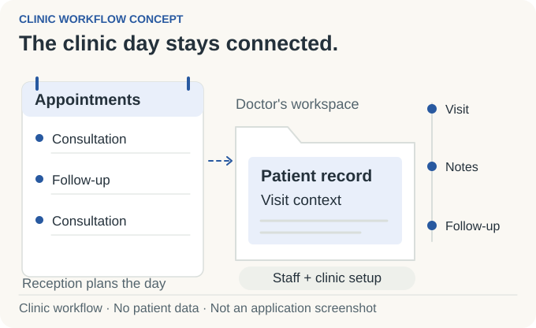
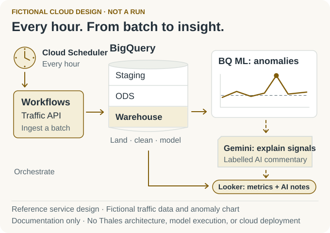
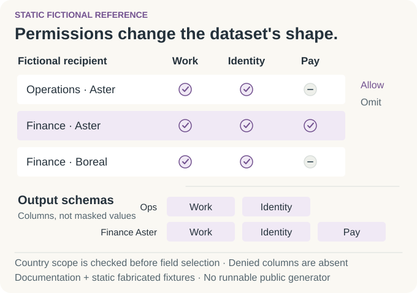
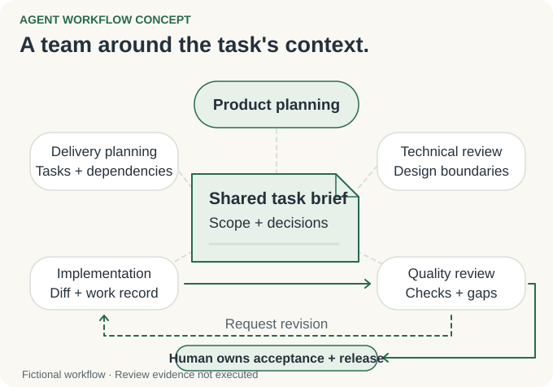

# From data pipelines to working products.

I'm **Mahdi Hajj Hassan**, a data engineer at **Thales**, based in **Beirut, Lebanon**. I developed data pipelines, designed AI workflows, and delivered products that connect the work of teams and businesses.

> [!CAUTION]
> **Engineering for critical workforce information**
> At Thales, I delivered data pipelines and reporting systems for critical HR information covering tens of thousands of employees worldwide. The work-related showcases below use fictional data and generic reference designs. They disclose no Thales code, systems, architecture, configuration, or critical data. These are independent portfolio demos with no Thales implementation or data, and no official Thales endorsement.

Selected projects, followed by the engineering behind them.

## 01 / HR Data Platform

I delivered pipelines, reporting systems, and datasets for AI model training, turning information from different sources into usable outputs for HR teams and other authorized audiences. The public showcase explains reporting, controlled sharing, and training-data delivery through a fictional reference.

<picture>
  <source media="(prefers-color-scheme: dark) and (max-width: 520px)" srcset="assets/workforce-story-v3-mobile-dark.svg">
  <source media="(max-width: 520px)" srcset="assets/workforce-story-v3-mobile-light.svg">
  <source media="(prefers-color-scheme: dark)" srcset="assets/workforce-story-v3-dark.svg">
  
</picture>

*Enterprise experience · Fictional public reference*

[Explore HR Data Platform →](https://github.com/MahdiHajjHassan/workforce-data-platform)

## 02 / Bringing a clinic's working day together

I developed **Doctoleb** around appointments, patient records, and visit administration. Its design connects the work of receptionists, doctors, and administrators, with multilingual interfaces and local operation for unreliable connectivity.

<picture>
  <source media="(prefers-color-scheme: dark) and (max-width: 520px)" srcset="assets/clinic-story-v3-mobile-dark.svg">
  <source media="(max-width: 520px)" srcset="assets/clinic-story-v3-mobile-light.svg">
  <source media="(prefers-color-scheme: dark)" srcset="assets/clinic-story-v3-dark.svg">
  
</picture>

*Personal product · Application source private · Public architecture showcase*

[Explore Doctoleb →](https://github.com/MahdiHajjHassan/doctoleb-showcase)

## 03 / Restaurant Websites

I developed a shared website product for restaurants: operators set up a business, owners maintain its menu and identity, and guests browse in English or Arabic. I connected restaurant domains, tenant-scoped data, brand controls, bilingual content, and photo processing in one codebase.

<picture>
  <source media="(prefers-color-scheme: dark) and (max-width: 520px)" srcset="assets/restaurant-story-v2-mobile-dark.svg">
  <source media="(max-width: 520px)" srcset="assets/restaurant-story-v2-mobile-light.svg">
  <source media="(prefers-color-scheme: dark)" srcset="assets/restaurant-story-v2-dark.svg">
  
</picture>

*Personal product · Source-backed application showcase · Concept illustration*

[Explore Restaurant Websites →](https://github.com/MahdiHajjHassan/Restaurant-app)

## 04 / GCP Data Pipeline

I built an ingestion-to-analytics pipeline with GCP Dataflow, BigQuery, and Cloud Workflows. This fictional traffic example explains an autonomous hourly workflow for analysts: collect API data, organize staging/ODS/warehouse layers in BigQuery, score unusual patterns, and present measurements with labelled AI interpretation in Looker.

<picture>
  <source media="(prefers-color-scheme: dark) and (max-width: 520px)" srcset="assets/gcp-story-v3-mobile-dark.svg">
  <source media="(max-width: 520px)" srcset="assets/gcp-story-v3-mobile-light.svg">
  <source media="(prefers-color-scheme: dark)" srcset="assets/gcp-story-v3-dark.svg">
  
</picture>

*Professional experience explained through an independent fictional design · Documentation only*

The service composition is a portfolio example, with no Thales architecture or critical data. Workflows coordinates the stages; BigQuery ML and Gemini illustrate anomaly scoring and interpretation rather than executed model results.

[Explore the GCP demo design →](https://github.com/MahdiHajjHassan/MahdiHajjHassan/blob/main/projects/gcp-data-pipeline/README.md)

## 05 / Different teams, different development data

I developed a configurable synthetic-data generator for teams that needed different views of a dataset. **PolicyForge**, its public fictional reference, asks a practical question: how do different teams get development data that reflects what they are allowed to use? It separates which records belong in a dataset from which fields each recipient can see. The examples use fictional policies and static fabricated fixtures.

<picture>
  <source media="(prefers-color-scheme: dark) and (max-width: 520px)" srcset="assets/policy-story-v2-mobile-dark.svg">
  <source media="(max-width: 520px)" srcset="assets/policy-story-v2-mobile-light.svg">
  <source media="(prefers-color-scheme: dark)" srcset="assets/policy-story-v2-dark.svg">
  
</picture>

*Documentation-only reference · Original implementation unavailable*

[Explore the synthetic-data reference →](https://github.com/MahdiHajjHassan/policy-aware-data-generator)

## 06 / Keeping AI work connected to product intent

I designed **AgentCrew**, an AI engineering workflow documented through a fictional reference: give each task a clear purpose, keep decisions with it, and carry that context through implementation and review. The fictional storefront example makes the handoffs concrete while a human owns design and release decisions.

<picture>
  <source media="(prefers-color-scheme: dark) and (max-width: 520px)" srcset="assets/ai-story-v2-mobile-dark.svg">
  <source media="(max-width: 520px)" srcset="assets/ai-story-v2-mobile-light.svg">
  <source media="(prefers-color-scheme: dark)" srcset="assets/ai-story-v2-dark.svg">
  
</picture>

*Independent fictional reference · Separate from my final-year project*

[Explore the AI workflow →](https://github.com/MahdiHajjHassan/ai-development-workflow)

---

## My technical toolkit

| Area | My toolkit |
| --- | --- |
| Languages | Python · C · C++ · JavaScript · TypeScript · Java · SQL / T-SQL · Bash |
| Applications | React · Next.js · NestJS · Node.js · FastAPI · Electron · electron-vite |
| Data and databases | SQL Server · PostgreSQL · Talend ETL · SSIS · SSMS · Stored procedures · ODS and warehouse modeling |
| Analytics and BI | Power BI · DAX · SSAS · Looker |
| Cloud | Google Cloud · Dataflow · BigQuery · Cloud Workflows |
| APIs and validation | SQLAlchemy · Pydantic · OpenAPI · JWT authentication · Role-based access |
| Systems | Linux / Unix · Processes and filesystems · Networking · System administration |
| Testing and engineering | pytest · API, unit, and integration testing · OOP · Data structures and algorithms · Debugging · Secure coding |
| Delivery | Docker · Git · GitHub · GitLab · GitLab CI/CD · Agile / Scrum · Code review |
| Collaboration | Jira · Miro · Microsoft Teams · Technical documentation · Peer evaluation |

<strong>Engineering background and technical details</strong>

### Enterprise data engineering

At Thales, I delivered data pipelines and reporting systems for critical HR data covering tens of thousands of employees worldwide. I coordinated delivery with other engineers and interns, clarified requirements with the product owner and discussed architecture with the technical lead.

My experience includes SQL Server and Talend ETL components, data modeling, validation, deployment, and production support. I have also worked with GCP Dataflow, BigQuery, and Cloud Workflows.

### Applications and AI workflows

My independent projects combined product requirements, application design, implementation, and review. Doctoleb's public technical notes cover React, TypeScript, browser persistence, and synchronization design.

I also built a multi-agent orchestration system for my final-year project. That project is separate from the fictional storefront workflow above.

### Systems foundations

I'm a **42 Beirut alumnus**. Completed projects developed my experience with C and C++, Unix processes and filesystems, networking, debugging, and peer review.

<a href="https://www.thalesgroup.com/"><picture><source media="(prefers-color-scheme: dark)" srcset="https://raw.githubusercontent.com/MahdiHajjHassan/MahdiHajjHassan/main/assets/thales-dark.svg"></picture></a>&nbsp;&nbsp;&nbsp;
<a href="https://www.42beirut.com/"><picture><source media="(prefers-color-scheme: dark)" srcset="https://raw.githubusercontent.com/MahdiHajjHassan/MahdiHajjHassan/main/assets/42-dark.svg"></picture></a>

### About the public references

The work-related showcases use generic patterns and fictional examples. They contain no employer code, internal identifiers, confidential schemas, real employee data, or confidential implementation details, and do not reproduce the employer's implementation. Concept illustrations explain a project; they are not application screenshots or verification results.

[Email](mailto:mahdihajjhassan.business@gmail.com) · [LinkedIn](https://www.linkedin.com/in/mahdi-hajj-hassan-5b953b312/)
