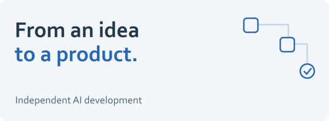

# AI development workflows

<picture><source media="(prefers-color-scheme: dark)" srcset="../assets/workflow-dark.svg"></picture>

**Turn an idea into a structured development process with clear ownership and review.**

This case study covers my independent personal work. It describes the workflow I use around AI agents and a demonstration built for a fictional retail company.

## The problem

A long conversation is a fragile place to keep product decisions, implementation rules, and the state of a project. Tasks become ambiguous, context gets repeated, and generated changes can be difficult to review.

My approach puts that context into the project and gives the workflow explicit responsibilities.

## How I structure the work

| Responsibility | What it produces |
| --- | --- |
| Product planning | A concrete problem, user needs, and acceptance criteria. |
| Delivery planning | A sequence of tasks with dependencies and a visible status. |
| Technical review | Architecture choices, implementation boundaries, and constraints. |
| Implementation | Changes scoped to the task and prepared for review. |
| Quality review | Checks against the acceptance criteria and evidence for the next decision. |

I retain control of system design, tradeoffs, and release decisions. Agents help carry out bounded work within that structure.

## A concrete demonstration

The storefront demonstration combines a small web application with:

- **Versioned instructions** for project structure and engineering conventions.
- **Reusable skills** for recurring work.
- **Ticket folders** that keep context, progress, and deliverables together.
- **Staged changes** that can be inspected before they enter the application.
- **A linked knowledge base** built from the same project documents.

The important artifact is the working process around the application: a visitor can see what the task was, which rules applied, and what changed.

## Why this matters

The workflow makes AI development easier to direct, review, and continue across tasks. Product intent, engineering constraints, and human decisions remain visible instead of being buried in a chat history.

<strong>Demonstration structure</strong>

The fictional storefront uses an Express REST API and a browser application in JavaScript. Its documentation separates project rules from technical mechanics. A ticket template provides context and output areas; the demonstration stages a small API change for review.

This public case study summarizes the workflow. The application source is not included here, and no claim is made about production deployment or measured productivity gains.

[Back to my profile](https://github.com/MahdiHajjHassan) · [See Doctoleb](doctoleb.md)
