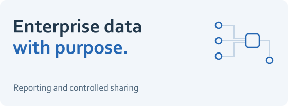

# Enterprise workforce data platform

<picture><source media="(prefers-color-scheme: dark)" srcset="../assets/workforce-dark.svg"></picture>

**Turn scattered workforce information into trusted reporting and controlled data sharing.**

This is an anonymized account of my enterprise data engineering experience. It describes responsibilities and common engineering patterns at a high level. The architecture outline is generic and contains no internal implementation details.

## The business need

HR teams need a consistent view of workforce information. Different systems, formats, and definitions make that difficult. The same information may also need to support approved exchanges with other organizations and downstream analytical work, with different visibility for each audience.

The engineering challenge is to make the data useful while preserving the boundaries around sensitive information.

## My contribution

I handle implementation across ingestion, transformation, data modeling, and delivery. I work with the product owner to translate requirements into concrete changes and discuss architecture with technical leadership. I coordinate day-to-day execution with other data engineers and interns, carrying approved designs into working pipelines and reporting structures.

## What the work enables

- **Business reporting:** consistent data behind interactive HR dashboards and decision-support views.
- **Controlled exchanges:** approved views for different recipient organizations and teams.
- **Downstream preparation:** structured datasets for authorized analytical and model-training consumers.
- **Scoped visibility:** access that reflects a person's role and country scope.

## Handling sensitive data

Country and role restrictions are part of the delivery design. A recipient's view is limited to the scope it is permitted to access; one broad business dataset does not imply one shared level of access.

I treat confidentiality as an engineering requirement across the pipeline, its outputs, and the way the work is documented.

<strong>Generic technical outline</strong>

| Layer | Purpose |
| --- | --- |
| Staging | Receive inputs and establish a controlled landing area. |
| Operational data store | Normalize operational records and relationships. |
| Data warehouse | Organize data for consistent analytical use. |
| Semantic / cube layer | Present business measures and reporting structures. |

The delivery surface includes dashboards, approved sharing views, and authorized downstream datasets. Data modeling, validation, and audience-specific access rules connect the layers to those uses.

This outline is a common reference pattern, not a reproduction of an employer's system.

[Back to my profile](https://github.com/MahdiHajjHassan) · [Explore the synthetic-data reference design](https://github.com/MahdiHajjHassan/policy-aware-data-generator)
