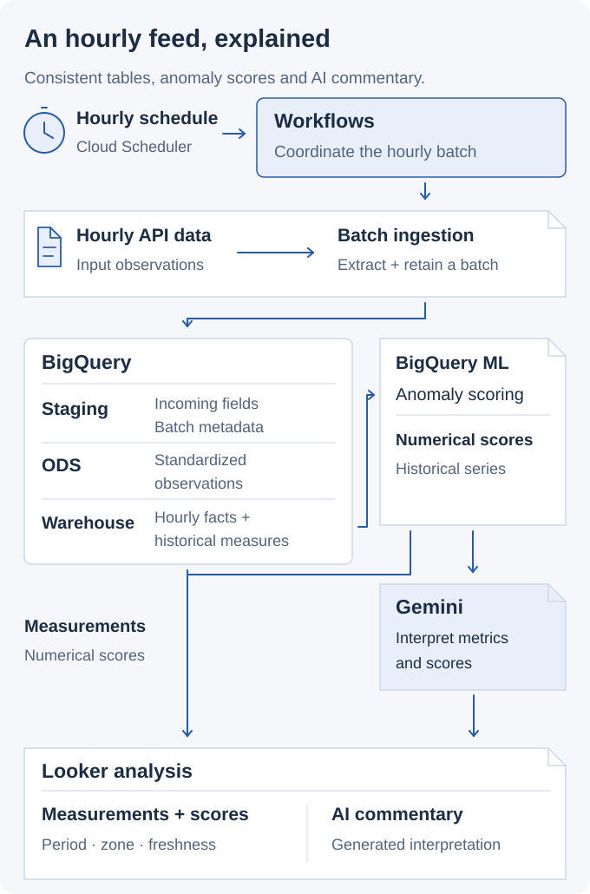
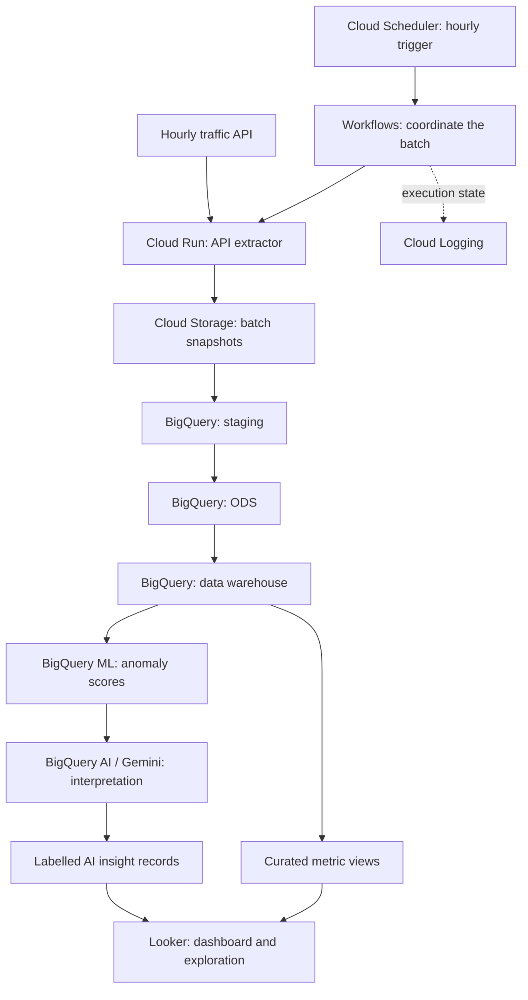

# GCP Data Pipeline | Analytics and AI Interpretation

> [!CAUTION]
> **Public cloud architecture.** I built a GCP ingestion-to-analytics pipeline; this traffic scenario is an independent design, with no Thales implementation or data and no employer endorsement. Service choices, example values and diagrams explain the architecture. This repository contains documentation, not deployed infrastructure or evaluated model results.

## Move incoming data into analysis people can use

I built a GCP ingestion-to-analytics pipeline for turning incoming data into structured analytical outputs. Its users are analysts and teams who need processed data for reporting and investigation.

**My contribution:** I connected data ingestion, processing and analytical delivery using **GCP Dataflow, BigQuery and Cloud Workflows**.

The traffic architecture below follows the analyst's next questions: what changed this hour, which areas look unusual, and which measurements explain the change? It connects hourly data, historical comparisons, anomaly scores and AI interpretation in one analytical workflow.

<picture>
  <source media="(prefers-color-scheme: dark) and (max-width: 520px)" srcset="assets/gcp-story-v5-mobile-dark.svg">
  <source media="(max-width: 520px)" srcset="assets/gcp-story-v5-mobile-light.svg">
  <source media="(prefers-color-scheme: dark)" srcset="assets/gcp-story-v5-dark.svg">
  
</picture>

### Traffic analytics workflow

| Stage | Responsibility | Output |
| --- | --- | --- |
| Ingest | Collect an hourly API batch and identify its observation period. | Incoming observations and batch metadata. |
| Prepare | Standardize timestamps, zone keys and numeric values. | Consistent observations for analysis. |
| Model | Build hourly measures and historical series. | Comparable metrics across periods and zones. |
| Analyze | Score unusual observations and interpret selected metrics. | Anomaly scores and structured AI commentary. |
| Present | Show measurements, scores and data freshness together. | An analyst's dashboard for investigation. |

### Measurements and AI interpretation

BigQuery ML supplies anomaly scores. Gemini interprets selected metrics and scores. Looker presents the underlying measurements alongside labelled commentary so the analyst can inspect the numbers behind an explanation.

Batch status and commentary availability are separate. If interpretation fails, the dashboard can still present the measured data and identify the missing commentary.

<strong>Engineering details: scheduled ingestion, data layers, and AI analysis</strong>

### Service flow

### Data layers

| Layer | Responsibility |
| --- | --- |
| Staging | Receive incoming fields and batch metadata. |
| Operational data store (ODS) | Standardize observations and resolve duplicate or revised records. |
| Data warehouse | Organize hourly facts and historical measures for analysis. |

### Responsibilities in the traffic architecture

| Service | Role |
| --- | --- |
| Cloud Scheduler and Workflows | Start hourly batches and coordinate their stages. |
| Cloud Run and Cloud Storage | Extract API data and retain batch snapshots. |
| BigQuery | Transform data and serve analytical views. |
| BigQuery ML | Score anomalies in historical series. |
| BigQuery AI / Gemini | Generate structured interpretation from selected metrics. |
| Looker | Present metrics, anomaly scores and commentary. |
| IAM, Secret Manager and Cloud Logging | Control service access, runtime secrets and operational visibility. |

The orchestration design tracks each batch through ingestion and analytical delivery, with failure handling for the data path and the interpretation stage.

- [Batch processing and failure handling](docs/reference-design.md)
- [Anomaly scoring and AI interpretation](docs/ai-analysis.md)

[Back to my portfolio](https://github.com/MahdiHajjHassan)
