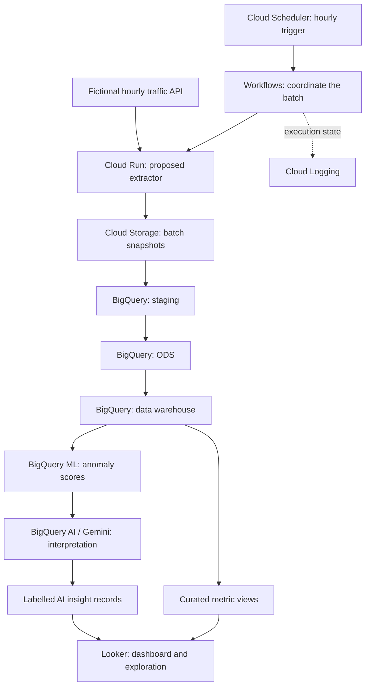

# GCP Data Pipeline

## Hourly data. Layered analytics. AI-assisted interpretation.

> [!CAUTION]
> **Independent portfolio demo — no Thales implementation or data.**
> This showcase uses fictional data and generic reference designs to explain engineering ideas from my professional experience. It does not reproduce, document, or disclose Thales's actual systems, architecture, configuration, or critical data. It is not an official Thales project or endorsement.

My professional experience includes GCP pipeline work connecting batch ingestion, orchestration, analysis, and reporting. This reference explains that class of work through a fictional traffic-data scenario: a feed changes every hour, new batches pass through three analytical layers, unusual patterns are scored, and a dashboard presents the measured trends alongside labelled AI interpretation.

*Independent reference design · Fictional traffic scenario · Documentation only; no cloud deployment or execution results supplied*

<picture>
  <source media="(prefers-color-scheme: dark) and (max-width: 520px)" srcset="assets/gcp-story-mobile-dark.svg">
  <source media="(max-width: 520px)" srcset="assets/gcp-story-mobile-light.svg">
  <source media="(prefers-color-scheme: dark)" srcset="assets/gcp-story-dark.svg">
  
</picture>

*Concept illustration of the fictional reference; not an employer system diagram or a pipeline run.*

### The analyst's question

What changed this hour, which areas look unusual, and what deserves attention? The demo is designed for transport analysts and operations teams who need a connected view of incoming data, historical context, and anomalies.

### Three layers, three responsibilities

| Layer | Purpose in the fictional design |
| --- | --- |
| Staging | Preserve batch identity and ingested shape so incoming data can be checked. |
| ODS | Normalize timestamps and zone keys, reconcile duplicates, and expose consistent operational observations. |
| Data warehouse | Build hourly measures and historical series for dashboard analysis and anomaly scoring. |

### Where AI adds context

The proposed design separates numerical evidence from generated interpretation. BigQuery ML scores unusual time-series observations; Gemini turns selected metrics and scores into a short, structured explanation. Looker shows the underlying numbers, data freshness, model flags, and labelled generated commentary together.

The autonomous aspect is the intended scheduled handoff between stages. Invalid batches stop at a quality gate; an AI failure does not silently become a successful insight. This is described behavior for the reference, not an implemented or measured guarantee.

<strong>Service roles and engineering detail</strong>

### A scheduled workflow from API to dashboard

*Proposed demo architecture. These service choices are not a diagram of the company system.*

| Service | Role in this proposed demo |
| --- | --- |
| Cloud Scheduler | Hourly workflow invocation. |
| Workflows | Stage dependencies, job coordination, bounded retries, and completion/failure paths. |
| Cloud Run | Proposed API extraction and input shaping. |
| Cloud Storage | Proposed reproducible batch snapshots. |
| BigQuery | Staging, ODS, warehouse queries, and dashboard-facing views. |
| BigQuery ML | Proposed time-series anomaly scoring. |
| BigQuery AI / Gemini | Proposed structured interpretation of selected metrics and model outputs. |
| Looker | Analytical exploration and dashboard presentation. |
| IAM / Secret Manager | Proposed service permissions and runtime secret boundaries. |
| Cloud Logging | Proposed execution and failure visibility. |

- [Reference architecture and workflow](docs/reference-design.md)
- [Anomaly analysis, AI interpretation, and dashboard concept](docs/ai-analysis.md)

Workflows, BigQuery, and Looker were named in the professional-experience account. The additional services and particular AI methods are independent choices for this fictional demo, not claims about the original implementation.

[Mahdi Hajj Hassan](https://github.com/MahdiHajjHassan)
