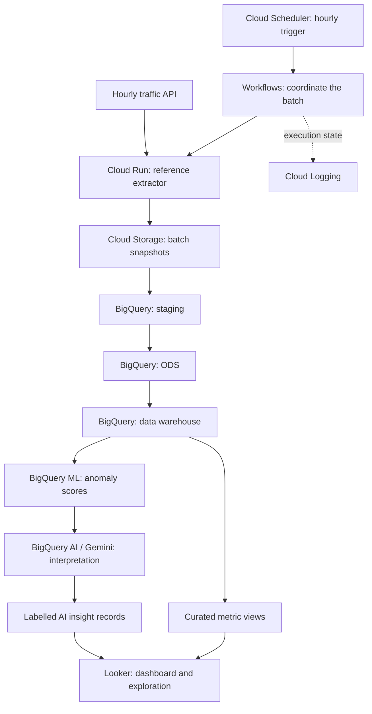

# GCP Data Pipeline

> [!CAUTION]
> **Professional experience, protected information.**
> This public showcase uses independent reference designs and fictional examples, with no Thales implementation or data. It discloses no employer code, systems, configuration, or critical information and carries no official endorsement. Diagrams explain the design; they are illustrations, not application screenshots or execution results. The traffic scenario and service composition are independent design choices. This repository supplies documentation rather than deployed infrastructure, model outputs, or evaluation results.

## Hourly data. Layered analytics. AI-assisted interpretation.

I built an ingestion-to-analytics pipeline with GCP Dataflow, BigQuery, and Cloud Workflows. The traffic-data workflow connects the same engineering concerns: a feed changes every hour, new batches pass through three analytical layers, unusual patterns are scored, and a dashboard presents the measured trends alongside labelled AI interpretation.

<picture>
  <source media="(prefers-color-scheme: dark) and (max-width: 520px)" srcset="assets/gcp-story-v4-mobile-dark.svg">
  <source media="(max-width: 520px)" srcset="assets/gcp-story-v4-mobile-light.svg">
  <source media="(prefers-color-scheme: dark)" srcset="assets/gcp-story-v4-dark.svg">
  
</picture>

### The analyst's question

What changed this hour, which areas look unusual, and what deserves attention? The workflow is designed for transport analysts and operations teams who need a connected view of incoming data, historical context, and anomalies.

### Three layers, three responsibilities

| Layer | Purpose |
| --- | --- |
| Staging | Preserve batch identity and ingested shape so incoming data can be checked. |
| ODS | Normalize timestamps and zone keys, reconcile duplicates, and expose consistent operational observations. |
| Data warehouse | Build hourly measures and historical series for dashboard analysis and anomaly scoring. |

### Where AI adds context

The reference design separates numerical evidence from generated interpretation. BigQuery ML scores unusual time-series observations; Gemini turns selected metrics and scores into a short, structured explanation. Looker shows the underlying numbers, data freshness, model flags, and labelled generated commentary together.

The autonomous aspect is the scheduled handoff defined in the reference between stages. Invalid batches stop at a quality gate; an AI failure does not silently become a successful insight.

<strong>Service roles and engineering detail</strong>

### A scheduled workflow from API to dashboard

| Service | Role in the workflow |
| --- | --- |
| Cloud Scheduler | Hourly workflow invocation. |
| Workflows | Stage dependencies, job coordination, bounded retries, and completion/failure paths. |
| Cloud Run | API extraction and input shaping. |
| Cloud Storage | Reproducible batch snapshots. |
| BigQuery | Staging, ODS, warehouse queries, and dashboard-facing views. |
| BigQuery ML | Time-series anomaly scoring. |
| BigQuery AI / Gemini | Structured interpretation of selected metrics and model outputs. |
| Looker | Analytical exploration and dashboard presentation. |
| IAM / Secret Manager | Service permissions and runtime secret boundaries. |
| Cloud Logging | Execution and failure visibility. |

- [Reference architecture and workflow](docs/reference-design.md)
- [Anomaly analysis, AI interpretation, and dashboard design](docs/ai-analysis.md)

[Mahdi Hajj Hassan](https://github.com/MahdiHajjHassan)
