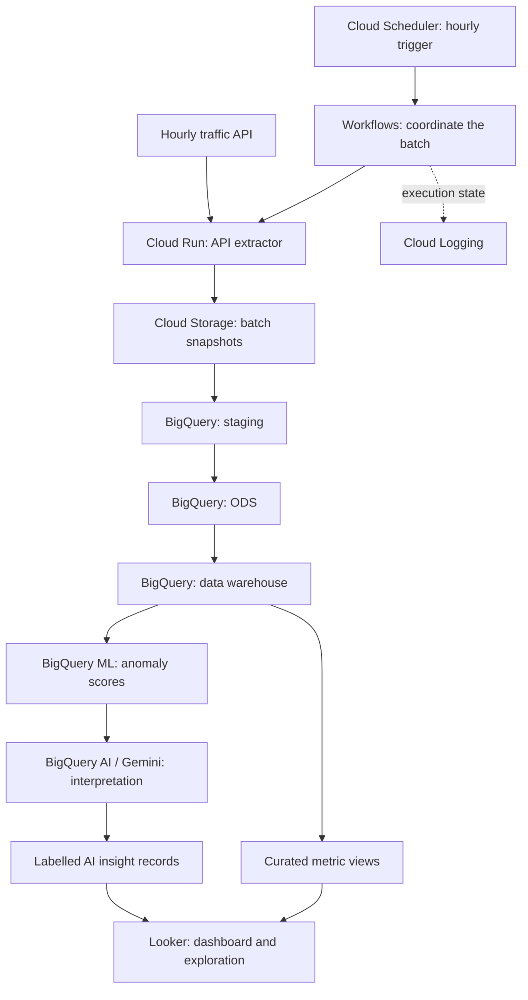

# GCP Data Pipeline | Analytics and AI Interpretation

> [!CAUTION]
> **Public cloud architecture.** I built a GCP ingestion-to-analytics pipeline; this traffic scenario is an independent design, with no Thales implementation or data and no employer endorsement. Service choices, example values and diagrams explain the architecture. This repository contains documentation, not deployed infrastructure or evaluated model results.

## Turn incoming data into useful analysis

I built an ingestion-to-analytics pipeline using **GCP Dataflow, BigQuery, and Cloud Workflows**. My contribution connected data ingestion, processing, and analytical delivery.

The traffic workflow explains the analyst's task: **what changed this hour, which areas look unusual, and what needs investigation?** It connects hourly API data to consistent tables, historical comparisons, anomaly scores, and AI commentary in a dashboard.

<picture>
  <source media="(prefers-color-scheme: dark) and (max-width: 520px)" srcset="assets/gcp-story-v5-mobile-dark.svg">
  <source media="(max-width: 520px)" srcset="assets/gcp-story-v5-mobile-light.svg">
  <source media="(prefers-color-scheme: dark)" srcset="assets/gcp-story-v5-dark.svg">
  
</picture>

### From an hourly feed to an analyst's view

1. Collect the new batch and identify its observation period.
2. Standardize timestamps, zone keys, and numeric values.
3. Build hourly measures and historical series.
4. Score unusual observations and generate an explanation of the selected metrics.
5. Show the measurements, scores, commentary, and data freshness together.

### Numbers first, AI interpretation alongside

BigQuery ML supplies anomaly scores. Gemini turns selected metrics and scores into a structured explanation. Looker presents the underlying measurements alongside clearly labelled generated commentary, so analysts can inspect the numbers behind an interpretation.

The workflow records batch failures and unavailable AI commentary separately. An interpretation failure does not make the measured data disappear.

<strong>Engineering details: scheduled ingestion, data layers, and AI analysis</strong>

### Data layers

| Layer | Job |
| --- | --- |
| Staging | Receive incoming fields and batch metadata. |
| Operational data store (ODS) | Standardize observations and resolve duplicate or revised records. |
| Data warehouse | Organize hourly facts and historical measures for analysis. |

### Service responsibilities

| Service | Job in the traffic architecture |
| --- | --- |
| Cloud Scheduler and Workflows | Start hourly batches and coordinate their stages. |
| Cloud Run and Cloud Storage | Extract API data and retain batch snapshots. |
| BigQuery | Transform data and serve analytical views. |
| BigQuery ML | Score anomalies in historical series. |
| BigQuery AI / Gemini | Generate structured interpretation from selected metrics. |
| Looker | Present metrics, anomaly scores, and commentary. |
| IAM, Secret Manager, and Cloud Logging | Control service access, runtime secrets, and operational visibility. |

- [Batch processing and failure handling](docs/reference-design.md)
- [Anomaly scoring and AI interpretation](docs/ai-analysis.md)

[Back to my portfolio](https://github.com/MahdiHajjHassan)
