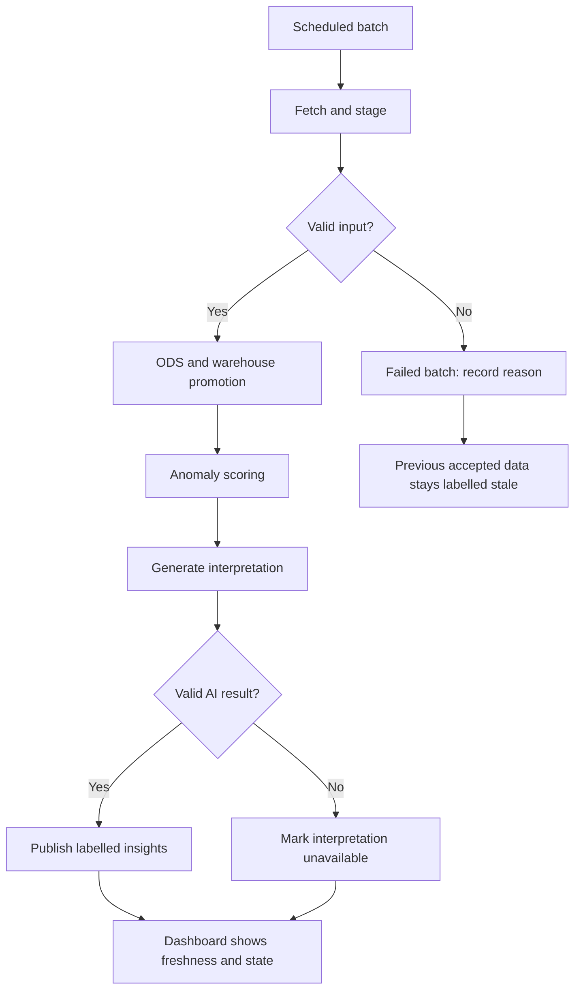

# GCP Data Pipeline | Batch Processing and Failure Handling

> [!CAUTION]
> **Public cloud architecture.** I built a GCP ingestion-to-analytics pipeline; this traffic scenario is an independent design, with no Thales implementation or data and no employer endorsement. Service choices, example values and diagrams explain the architecture. This repository contains documentation, not deployed infrastructure or evaluated model results.

The traffic architecture carries the observation period, batch identity, processing status, and quality checks from ingestion to the dashboard.

## Batch data

A traffic observation contains an hour, zone, trip count, and average duration. A batch manifest identifies the batch, observation interval, schema version, and processing state. This analysis operates on hourly aggregates.

## Three analytical layers

| Layer | Contents | Checks before the next stage |
| --- | --- | --- |
| Staging | Received fields and batch metadata. | Schema, input size, and recognized zones. |
| Operational data store (ODS) | Standard timestamps, units, and observations keyed by zone/hour. | Duplicate and revision rules, numeric ranges, and consistent keys. |
| Warehouse | Hourly facts, zone dimensions, and historical measures. | Accepted batch and agreed metric definitions. |

BigQuery holds the three logical datasets. Cloud Storage retains batch snapshots, Workflows coordinates the jobs, and Cloud Run handles API extraction.

## Success and failure paths

The design uses batch identifiers to avoid promoting the same input twice. Retries are bounded, the latest successful interval is recorded, and AI interpretation errors have their own status.

A failed batch leaves the previous accepted data visible with a stale indicator. A failed interpretation leaves the measurements available and marks the commentary unavailable. Model retraining is handled as a separate controlled job.

## Service access and visibility

Cloud Scheduler invokes Workflows on the hourly schedule. Workflows coordinates HTTP services and BigQuery jobs. IAM defines service permissions, Secret Manager holds runtime credentials, and Cloud Logging records execution and failures.

- [Schedule a workflow](https://docs.cloud.google.com/workflows/docs/schedule-workflow)
- [Workflows overview](https://docs.cloud.google.com/workflows/docs/overview)

[Project overview](../README.md) · [Anomaly scoring and AI interpretation](ai-analysis.md)
