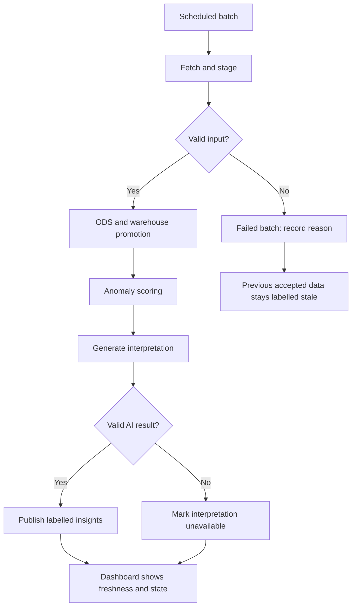

# GCP Data Pipeline reference architecture

> [!CAUTION]
> **Professional experience, protected information.**
> This public showcase uses independent reference designs and fictional examples, with no Thales implementation or data. It discloses no employer code, systems, configuration, or critical information and carries no official endorsement. Diagrams explain the design; they are illustrations, not application screenshots or execution results. The traffic scenario and service composition are independent design choices. This repository supplies documentation rather than deployed infrastructure, model outputs, or evaluation results.

The workflow carries batch identity, processing state, and data-quality decisions from ingestion through analytical delivery.

## Hourly batch contract

A traffic observation contains an hour bucket, zone, trip count, and average duration. A reference batch manifest records a batch ID, observation interval, schema version, and processing state. Neither individual taxi journeys nor driver/customer identifiers are needed for the reference.

## Analytical layers

| Layer | Reference contents | Promotion condition |
| --- | --- | --- |
| Staging | Batch metadata and received observation fields. | Valid schema, bounded input, recognized zones. |
| ODS | Standard timestamps/units and reconciled observations keyed by zone and hour. | Explicit duplicate/revision rules and valid numeric values. |
| Warehouse | Hourly facts, zone dimensions, and historical analytical measures. | Accepted batch and consistent metric definitions. |

BigQuery represents the three logical datasets. Cloud Storage can retain raw snapshots for replay. Workflows coordinates the jobs; custom extraction belongs in the reference Cloud Run component.

## Completion and failure paths

The reference design specifies batch identity to avoid duplicate promotion, bounded retry policies, an explicit latest-success marker, and separately recorded AI errors. Model retraining is a separate controlled job, not silently retried inside every hourly ingestion step.

## Reference services

[Cloud Scheduler can invoke Workflows on a schedule](https://docs.cloud.google.com/workflows/docs/schedule-workflow). [Workflows can coordinate HTTP services and BigQuery jobs](https://docs.cloud.google.com/workflows/docs/overview). The reference permissions and runtime-secret design uses IAM and Secret Manager; logs avoid credentials or raw source records.

[Project overview](../README.md) · [AI analysis](ai-analysis.md)
